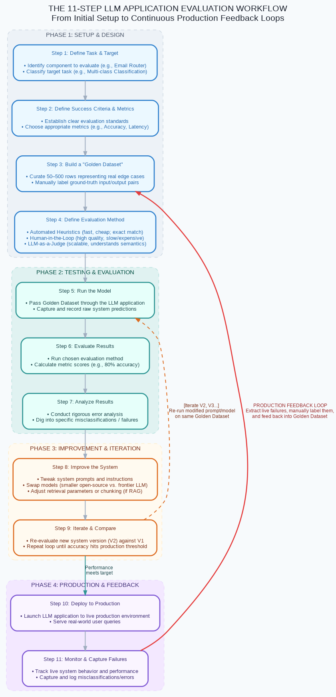
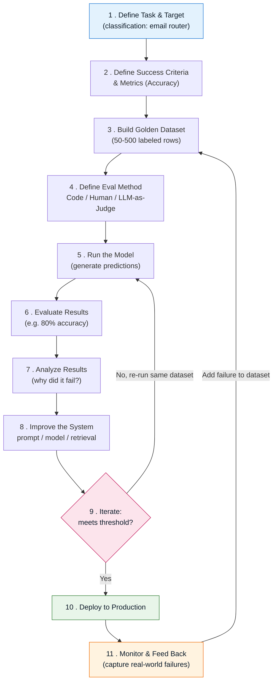

# The LLM Application Evaluation Workflow — Notes

> Transitioning from understanding **what** LLM evaluations are to **how** to
> practically perform them on LLM-powered applications.

---

## Table of Contents

1. [Case Study: Zomato Email Router](#1-case-study-zomato-customer-support-email-router)
2. [The Step-by-Step Evaluation Loop](#2-the-step-by-step-llm-application-evaluation-loop)
3. [Key Takeaway: Multi-Eval Architectures](#3-key-takeaway-multi-eval-architectures)
4. [Visual Flowchart](#4-visual-flowchart-of-the-11-step-loop)

---

## 1. Case Study: Zomato Customer Support Email Router

A simple, practical example used to illustrate the complete evaluation workflow.

| Element | Detail |
| --- | --- |
| **The Problem** | A large company like Zomato receives thousands of customer emails daily. Manually reading and routing them to the correct teams is slow and expensive. |
| **The Solution** | Build a simple LLM application that acts as an **email router** — reads an incoming email and classifies it. |
| **The Setup** | An LLM is given a system prompt specifying it is a routing agent. Input = customer email; output = classification. |
| **The Question** | Before deploying to production, **how do we evaluate it** to ensure it is safe and reliable? |

**The three routing categories:**

1. **Billing Related** → routed to the **Billing Team**
2. **Technical Issues** → routed to the **Technical Team**
3. **General Queries** → routed to the **Customer Support Team**

---

## 2. The Step-by-Step LLM Application Evaluation Loop

The evaluation of any LLM-powered system — whether a simple router or a complex
multi-agent system — follows a structured, continuous loop.

### Step 1 — Define Task and Target
Clearly define **what** you are evaluating and the nature of the task. Here, the target
is the entire routing workflow, and the task is a **classification task**.

### Step 2 — Define Success Criteria & Metrics
Establish how you'll measure success. For a classification task, the most
straightforward metric is **Accuracy** (e.g., 90/100 emails routed correctly = 90%).

### Step 3 — Build a "Golden Dataset"
Construct a high-quality test dataset — the **Golden Dataset**.

- **Structure:** a table containing the input (email text) and the ground-truth label (Billing / Technical / General).
- **Size:** typically **50 to 500 rows**.
- **Creation:** best practice is to extract **real-world** customer interactions and manually label them to capture authentic edge cases.

### Step 4 — Define the Evaluation Method
Decide *who* or *what* compares the system's outputs against the ground-truth labels.
There are **three primary methods**:

| Method | Best for | Trade-offs |
| --- | --- | --- |
| **Automated Code / Heuristics** | Simple classification or exact-match tasks. A Python script compares output vs. label and computes accuracy. | ✅ Fast, cheap, no complex logic. |
| **Human-in-the-Loop** | Comparing long-form paragraphs or complex conversational outputs. | ❌ Slow and expensive at scale. |
| **LLM-as-a-Judge** | A middle ground — a capable LLM (e.g., GPT-4) reads output + ground truth, assesses semantic meaning/quality, and scores it. | ⚖️ Balances scalability and nuance. |

### Step 5 — Run the Model
Pass the **entire** test dataset through your LLM application to generate raw
predictions for every input case.

### Step 6 — Evaluate Results
Run your evaluation method (e.g., the Python accuracy script) to calculate the final
performance metric. For example, the initial run might yield **80% accuracy**.

### Step 7 — Analyze Results
Identify **where** the system failed. Examine the 20% of misclassified cases to
understand *why* (e.g., did it confuse a technical bug with a billing error?).

### Step 8 — Improve the System
Based on the error analysis, tweak the system. Common improvements:

- Refining/updating the **System Prompt** to clarify confusing edge cases.
- **Swapping the model** (e.g., upgrading a smaller open-source model to a frontier model).
- Adjusting **retrieval, memory, or chunking** strategies (for RAG systems).

### Step 9 — Iterate
Because LLM evals are **repeatable**, re-run the modified system through the *exact
same* Golden Dataset. Compare V2 vs. V1 — if accuracy jumps 80% → 95%, your changes
worked. Keep iterating until you hit your production threshold.

### Step 10 — Deploy
Once the system achieves a satisfactory score and is deemed reliable, deploy it online.

### Step 11 — Monitor and Feed Back
Even a 95%-accurate system meets novel edge cases in production. Continuously monitor
real-world performance.

- **The Feedback Loop:** when the system fails in production (e.g., a billing complaint wrongly routed to the technical team, which flags the error), **capture that failure**.
- Add the real-world failure back into your **Golden Dataset**, and restart the loop. Over time, the Golden Dataset becomes richer and more robust.

---

## 3. Key Takeaway: Multi-Eval Architectures

In production, a single LLM-powered application rarely relies on just one evaluation
pipeline. **A single application may run several distinct LLM evals concurrently.**

For example, in a complex **Retrieval-Augmented Generation (RAG)** system, you might run
separate, isolated pipelines for:

- Testing the **retriever's performance** (correct context is pulled).
- Checking the quality of the **embedding model**.
- Assessing **overall system latency**.
- Evaluating **end-to-end response generation** for accuracy and safety.

---

## 4. Visual Flowchart of the 11-Step Loop

The primary diagram below organises the 11 steps into **4 phases** and shows both
feedback loops. The editable Mermaid source is also included below.

**The 4 phases:**

| Phase | Steps | Focus |
| --- | --- | --- |
| **1 · Setup & Design** | 1–4 | Define task, metrics, Golden Dataset, and eval method |
| **2 · Testing & Evaluation** | 5–7 | Run the model, score results, analyze failures |
| **3 · Improvement & Iteration** | 8–9 | Fix the system, then re-run V2 vs. V1 on the same dataset |
| **4 · Production & Feedback** | 10–11 | Deploy, then capture live failures back into the loop |

**Two feedback loops to notice:**

- 🟠 **Iterate loop (Step 9 → Step 5):** re-run the modified prompt/model on the *same* Golden Dataset until it passes the threshold.
- 🔴 **Production feedback loop (Step 11 → Step 3):** extract live failures, label them, and feed them back into the Golden Dataset so it grows richer over time.

Editable Mermaid source (renders in Mermaid-aware previews)

---

*Notes on the LLM Application Evaluation Workflow — practical, step-by-step.*
