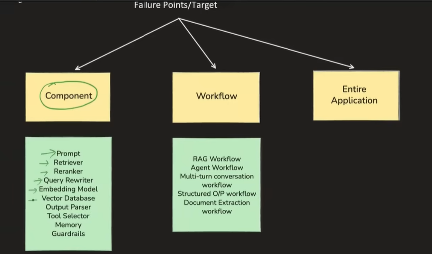

# Why LLM Applications Need Multiple Eval Pipelines — Notes

> In production, a single LLM-powered application **rarely relies on just one evaluation
> pipeline**. Almost all production-grade LLM apps run **multiple evaluation pipelines
> concurrently.**

There are two fundamental reasons for this:

1. **Multiple Failure Points** — the app can break at different *levels*.
2. **Multiple Risk Categories** — even one part can go wrong in different *dimensions*.

---

## Table of Contents

1. [Core Reason 1: Multiple Failure Points](#1-core-reason-1-multiple-failure-points)
   - [A. Component-Level Failures](#a-component-level-failures)
   - [B. Workflow-Level Failures (the K=5 RAG breakdown)](#b-workflow-level-failures--the-k5-rag-breakdown)
   - [C. Application-Level Failures (the latency trap)](#c-application-level-failures--the-latency-trap)
2. [Core Reason 2: Multiple Risk Categories](#2-core-reason-2-multiple-risk-categories)
   - [The three categories, held cleanly apart](#the-three-categories-held-cleanly-apart)
3. [The Comprehensive Risk Categorization Matrix](#3-the-comprehensive-risk-categorization-matrix)

---

## 1. Core Reason 1: Multiple Failure Points

An LLM application is built out of several moving parts. Failures can occur at **three
distinct levels**: **Component-Level**, **Workflow-Level**, and **Application-Level**.



*The diagram splits the "target" of evaluation into three levels. **Component** covers
individual building blocks (Prompt, Retriever, Reranker, Query Rewriter, Embedding
Model, Vector Database, Output Parser, Tool Selector, Memory, Guardrails). **Workflow**
covers how those blocks interact (RAG, Agent, Multi-turn conversation, Structured-output,
Document-extraction workflows). **Entire Application** covers the whole system in
production.*

### A. Component-Level Failures

Every individual building block of your application can fail **independently**.

- In a **RAG (Retrieval-Augmented Generation)** system:
  - The **Retriever** might fetch completely irrelevant documents from the Vector Database.
  - The **Generator** (the LLM) might ignore the provided context and hallucinate facts.
- In other applications, individual failures can occur in **prompt templates, embedding
  models, output parsers, memory systems, agent tools, or safety guardrails**.

> 🔑 **Each of these components needs its own dedicated evaluation.**

### B. Workflow-Level Failures — the K=5 RAG breakdown

> The crucial insight: **even when every individual component passes its own evaluation
> perfectly, the system can still fail** because of *how the components interact*.

**The scenario** — a user asks a RAG chatbot:
*"What is the duration of the Machine Learning course?"*

| Stage | What happens | Component verdict |
| --- | --- | --- |
| **Retriever (K = 5)** | Fetches the top-5 most semantically similar docs. **D1–D4** = irrelevant/tangential. **D5** = *"The duration of the Machine Learning course is 8 weeks."* | ✅ **Success** — the correct answer *was* pulled within the 5 slots. |
| **Generator** | Gets the query + all 5 docs. Its prompt says *prioritize higher-ranked documents*. D1–D4 rank higher, and **D2** says *"The Python course duration is 6 weeks."* Obediently, it outputs: *"The duration of the Machine Learning course is 6 weeks."* | ✅ **Success** — stayed grounded in context, did **not** hallucinate, and followed its priority instructions. |
| **Workflow (end-to-end)** | The user received a **wrong answer**. | ❌ **TOTAL FAILURE** |

**Why this matters:** both components scored a perfect pass, yet the product failed. Only
a **Workflow-Level Evaluation** — one that checks the end-to-end relationship between
*query → retrieved context → final answer* — can catch this.

**The fix:** insert a **Re-ranker** between the Retriever and Generator. The Re-ranker
re-orders the retrieved documents, moving the highly relevant **D5 to the top slot** and
clearing up the Generator's confusion.

```
Query → Retriever → [ Re-ranker ] → Generator → Answer
                         ▲
             re-orders so D5 (correct) is ranked #1
```

### C. Application-Level Failures — the latency trap

Suppose your component-level **and** workflow-level evals are all green — retrieval is
outstanding, generation is accurate, the re-ranker works.

- But running all these steps sequentially makes the chatbot take **10 seconds** per response.
- Users in production **cannot wait 10 seconds**. The product is effectively unusable.

> 🔑 **Takeaway:** you must establish **Application-Level Evaluations** to monitor overall
> operational metrics like **system latency, cost per token, and throughput.**

**The three failure levels at a glance:**

| Level | Question it answers | Example failure |
| --- | --- | --- |
| **Component** | "Does each building block work on its own?" | Retriever returns irrelevant docs |
| **Workflow** | "Do the blocks work *together* correctly?" | K=5 RAG breakdown → wrong final answer |
| **Application** | "Is the whole system usable in production?" | 10-second latency makes it unusable |

---

## 2. Core Reason 2: Multiple Risk Categories

Even within a *single* component or workflow, there are multiple **dimensions of risk**.
We organize them into three broad categories: **Application Quality**, **Safety**, and
**Operations**.

### The three categories, held cleanly apart

| Category | The one-line question | What it's really about |
| --- | --- | --- |
| **Application Quality** | *"Is the answer any good?"* | The **content** of the answer — does the app do its actual job well? |
| **Safety** | *"Could the answer cause harm?"* | The **harm** the answer could do — not whether it's good, but whether it's dangerous. |
| **Operational** | *"Is it fast, cheap, and reliable enough to run?"* | The **system** producing the answer — practical to operate at scale? |

**Expanded:**

- **Application Quality — "Is the answer any good?"**
  Whether the app does its actual job well: gives **correct, relevant, complete** answers
  that do what the user asked. This is the core *"does it work"* question — the thing the
  product exists to do.

- **Safety — "Could the answer cause harm?"**
  Whether the app avoids hurting anyone or exposing anything it shouldn't: **no toxic or
  dangerous content, no bias against groups, no leaking private data, no getting tricked
  into breaking its own rules.** Not about whether the answer is good, but whether it's
  harmful.

- **Operational — "Is it fast, cheap, and reliable enough to run?"**
  Whether the app is practical to operate at scale: **responds quickly, doesn't cost too
  much per answer, and doesn't crash or fail under real traffic.** Not about what the
  answer says, but about the system delivering it.

> 🧭 **The clean way to hold the three apart:**
> **Quality** = the *content* of the answer · **Safety** = the *harm* the answer could do ·
> **Operational** = the *system* producing it.

---

## 3. The Comprehensive Risk Categorization Matrix

The specific, critical risk dimensions developers evaluate across different LLM
application architectures.

| Category | Sub-Category / Architecture | Risk Dimension | Description |
| :--- | :--- | :--- | :--- |
| **Application Quality** | **General LLM Apps** (e.g. summarisers) | **Correctness & Accuracy** | Is the generated information factually correct? |
| | | **Relevance** | Does the output directly answer the user's prompt? |
| | | **Completeness** | Are all parts of the user's query fully addressed? |
| | | **Instruction Following** | Does the model adhere to specified lengths, formats, or tones? |
| | **RAG-Specific** | **Context Relevance** | Are the retrieved documents actually relevant to the query? |
| | | **Retriever Recall** | Did the retriever pull *all* the necessary context? |
| | | **Groundedness / Faithfulness** | Is the answer strictly based on the context (no hallucinations)? |
| | | **Citation Accuracy** | Are citations mapped to the correct source documents? |
| | **Agent-Specific** | **Tool Selection** | Does the agent choose the correct tool for the task? |
| | | **Parameter Correctness** | Are tools called with the correct argument types and values? |
| | | **Task Completion** | Does the agent successfully finish the user's objective? |
| | | **Error Recovery** | Can the agent recover if an intermediate tool step fails? |
| | **Multi-turn Chatbots** | **Context Retention** | How well does the bot recall facts from earlier in the chat? |
| | | **Clarification Behaviour** | Does the bot ask clarifying questions when given vague inputs? |
| **Safety** | **All Systems** | **Toxicity** | Is the response free from abusive or offensive language? |
| | | **Harmful Content** | Ensures no instructions on self-harm, weapons, or illegal acts. |
| | | **Bias** | Does the system treat all user demographics equally? |
| | | **PII Leakage** | Does it prevent leaking emails, credit cards, or credentials? |
| | | **Prompt Injection** | Can malicious inputs override the system instructions? |
| **Operations** | **All Systems** | **Latency** | Total time taken to return a completed response. |
| | | **Cost per Request** | The financial cost incurred per individual run. |
| | | **Token Efficiency** | Optimising the number of input and output tokens used. |
| | | **Error / Failure Rate** | Ratio of failed API/system runs to successful ones. |
| | | **Latency under Load** | System response times when many concurrent users are online. |

---

*Notes on why production LLM applications need multiple concurrent eval pipelines —
failure levels, the K=5 RAG case study, and the risk-category matrix.*
