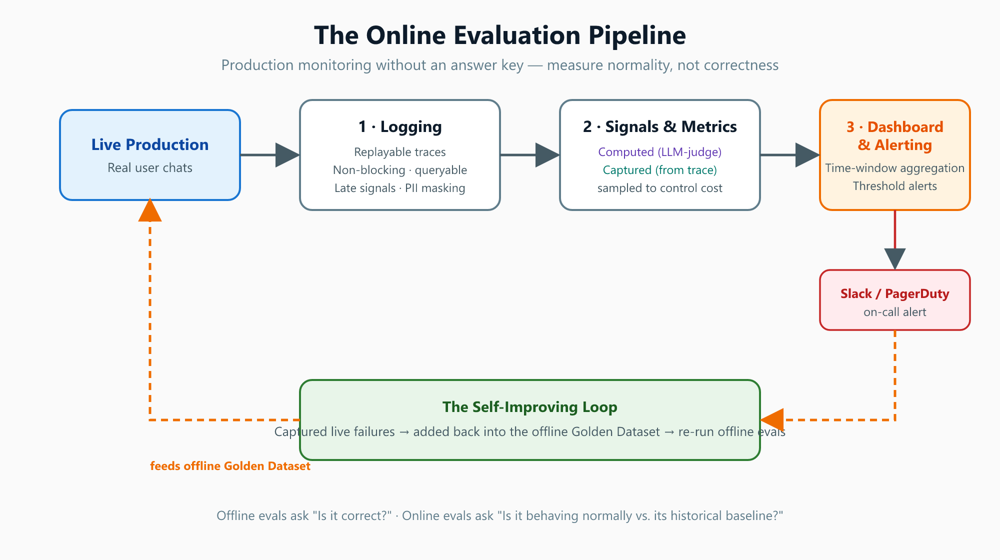
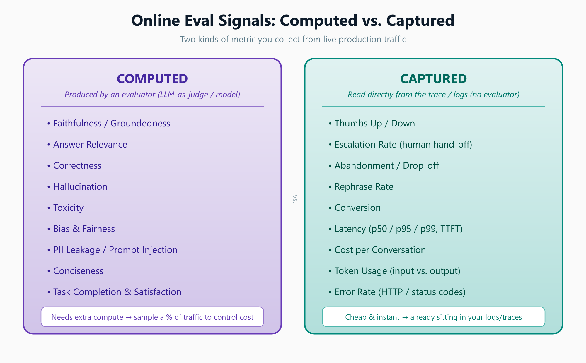

# Offline Evals vs. Online Evals — Notes

> The paradigm shift from **offline** environments (pre-deployment, with an answer key)
> to **online** environments (live production, without one). The heart of online evals is
> the distinction between **Computed** and **Captured** criteria.

---

## Table of Contents

1. [The Paradigm Shift](#1-the-paradigm-shift)
2. [Offline Evaluations (Recap & Core Purposes)](#2-offline-evaluations-recap--core-purposes)
3. [The Limitations of Offline Evals](#3-the-limitations-of-offline-evals)
4. [Online Evaluations (The Live Frontier)](#4-online-evaluations-the-live-frontier)
5. [The Online Evaluation Pipeline Architecture](#5-the-online-evaluation-pipeline-architecture)
6. [Computed vs. Captured — the core distinction](#6-computed-vs-captured--the-core-distinction)
7. [Captured Criteria — Detailed](#7-captured-criteria--detailed)
8. [Computed Criteria — Detailed](#8-computed-criteria--detailed)
9. [Dashboarding & Alerting](#9-dashboarding--alerting)
10. [The Self-Improving Loop](#10-the-self-improving-loop)

---

## 1. The Paradigm Shift

| | **Offline Evals** | **Online Evals** |
| --- | --- | --- |
| **When** | Before deployment (development / CI-CD) | Continuously, after deployment (production) |
| **Data** | Static **Golden Dataset** with ground-truth answers | Live, unpredictable real user traffic — **no answer key** |
| **Core question** | *"Is the output **correct**?"* | *"Is the system behaving **normally** vs. its historical baseline?"* |
| **Repeatable?** | Yes — same dataset, run any time | No — traffic is never the same twice |

---

## 2. Offline Evaluations (Recap & Core Purposes)

Offline evals run against a curated Golden Dataset **before** shipping. Three core uses:

- **Pre-release Testing & Automated Release Gates**
  Wire evals into **CI/CD pipelines**. A build only deploys if it clears a **threshold
  score** (e.g. "accuracy ≥ 90%"). Below threshold → the pipeline **blocks the
  deployment** automatically. This turns evals into an objective release gate rather than
  a manual judgment call.

- **Version Comparison**
  Run two configurations under **identical test conditions** and compare — e.g. OpenAI
  vs. Anthropic models, or Prompt V1 vs. Prompt V2. Because the dataset is fixed, the
  comparison is fair and reproducible.

- **Regression Testing**
  A small prompt tweak to fix one case can silently **break performance elsewhere**.
  Re-running the *full* Golden Dataset after every change catches these regressions
  before they reach users.

---

## 3. The Limitations of Offline Evals (The Reality of Production)

A Golden Dataset, however good, can never fully anticipate production. Three failure modes:

- **Unanticipated Live Inputs**
  Real users do things your test set never imagined: **Hindi-English code-switching**
  ("mera payment fail ho gaya"), **angry rants**, typos, emojis, and **adversarial prompt
  injections** trying to override the system prompt.

- **Emergent & Systematic Failures at Scale**
  Some failures only appear in aggregate:
  - **Latency spikes** under concurrent load that never show up on a single-request test.
  - **Subtle behavioral biases** visible only across *thousands* of chats, not one row.

- **Data & System Drift**
  The world changes but your Golden Dataset doesn't. Course **pricing** changes, **policies**
  update, **curricula** get revised — and yesterday's ground-truth answers become **wrong**.
  A dataset that was 95% accurate slowly rots as reality drifts away from it.

> 🔑 Offline evals prove the system *was* good against a fixed snapshot. Only online evals
> tell you it's *still* good against a moving world.

---

## 4. Online Evaluations (The Live Frontier)

Online evals operate in production with **no answer key and no static Golden Dataset**.

The key conceptual shift:

- ❌ You **cannot** measure **Correctness** in real time — that needs human-graded ground
  truth, which doesn't exist for live traffic as it happens.
- ✅ Instead you monitor **Normality** — compare current behavior against **historical
  statistical baselines**. You don't know if *this* answer is right, but you *can* know
  that "refund complaints jumped 3× vs. last week" or "p95 latency doubled since the
  deploy." Anomalies against the baseline are your alarm bells.

---

## 5. The Online Evaluation Pipeline Architecture

Three stages: **Logging → Signals & Metrics → Dashboarding & Alerting.**

### Step 1 — Logging
Capture **replayable conversation records**. Engineering requirements:

| Requirement | Why it matters |
| --- | --- |
| **Non-blocking execution** | Logging must never add latency to the user's response — write async / fire-and-forget. |
| **High queryability** | You'll slice by time, user, model, error — logs must be structured and searchable, not raw text dumps. |
| **Late-signal attachment** | Some signals arrive *hours later* (e.g. a support email sent after the chat). You must map that back to the specific chatbot session/trace. |
| **PII masking / scrubbing** | Strip emails, phone numbers, card numbers, credentials **before** they land in logs, for privacy & compliance. |

### Step 2 — Signals & Metrics
The two families: **Captured** (read straight from the trace) and **Computed** (produced
by an evaluator). Detailed in sections 7 and 8.

### Step 3 — Dashboarding & Alerting
Aggregate traces over **time windows** (hourly, daily) on platforms like **LangSmith**,
and set **threshold alerts** that page a human (Slack, PagerDuty). Detailed in section 9.

---

## 6. Computed vs. Captured — the core distinction

| | **Captured** | **Computed** |
| --- | --- | --- |
| **Source** | Read **directly from the trace / logs** | **Produced by an evaluator** (LLM-as-a-judge or a model) |
| **Cost** | Cheap & instant — it's already in your logs | Extra compute per item → usually **sampled** |
| **Nature** | Objective system/behavioral facts | Judgments about the *content* of the answer |
| **Examples** | Latency, cost, tokens, error rate, thumbs up/down, escalation | Faithfulness, relevance, toxicity, hallucination, jailbreak |

> **Mental model:** *Captured = things you can read off the receipt.
> Computed = things you need a grader to judge.*

---

## 7. Captured Criteria — Detailed

These are read straight from the trace — no evaluator needed.

### Latency
Total time to produce a response. Two things to track:
- **Total latency** — full request → complete answer.
- **TTFT (Time To First Token)** — how long until the *first* token appears. For streaming
  chatbots this drives *perceived* speed; a low TTFT feels responsive even if the full
  answer takes longer.
- **Report percentiles, not averages:** **p50 / p95 / p99**. p50 (median) is the typical
  user; **p95/p99** are the unlucky tail — the slowest 5% / 1% of requests. Averages hide
  the tail, and the tail is where users rage-quit. *"p99 latency = 9s"* means 1 in 100
  users waits 9 seconds.

### Cost per Conversation
The financial cost of each conversation (API spend). Watch it per-conversation, not just
in total, so a single expensive runaway loop (an agent calling tools 40 times) is visible.

### Token Usage
Count **input vs. output tokens** separately — they're priced differently and tell
different stories. Ballooning input tokens often means bloated context/retrieval;
ballooning output tokens means the model is over-generating (also hurts latency & cost).

### Error Rate
Ratio of failed runs to total — driven by **HTTP / status codes** (429 rate-limits, 500s,
timeouts, provider outages). A spike here is usually infrastructure, not model quality.

### Direct User Feedback
Signals the user gives *explicitly*:
- **Thumbs up / down** on a response.
- **Star ratings.**
These are gold (real human judgment) but **sparse** — most users never click anything.

### User Behavioral Proxies
Implicit signals inferred from *what users do* — a proxy for dissatisfaction:
- **Escalation / human hand-off rate** — user asks for a real agent → the bot failed them.
- **Abandonment / drop-off** — user leaves mid-conversation without resolution.
- **Rephrase rate** — user re-asks the same thing differently → the bot didn't understand.
- **Conversation length** — unusually long chats can signal the bot is going in circles.
- **Conversion** — did the user complete the goal (purchase, signup, ticket resolved)? The
  ultimate business-level captured signal.

---

## 8. Computed Criteria — Detailed

These require an **evaluator** (typically an **LLM-as-a-judge**) to read the content and
score it. Because each one costs extra compute, they're run on a **representative sample**
of traffic rather than every single request — keeping cost under control while still
tracking the trend.

### Faithfulness / Groundedness
Is the answer **strictly supported by the retrieved context**? For RAG, this is the
anti-hallucination check: every claim in the answer should trace back to a source
document. Low groundedness = the model is inventing beyond its context.

### Answer Relevance
Does the response actually **address the user's question**? An answer can be perfectly
factual and grounded yet still off-topic — relevance catches that.

### Context Relevance
Were the **retrieved documents themselves relevant** to the query? This isolates a
*retriever* problem from a *generator* problem: if context relevance is low, fix
retrieval, not the prompt.

### Correctness
Is the information **factually correct**? In production this is approximated by the judge
(no ground truth in real time), so it's a *confidence signal*, not a verdict.

### Hallucination
Detects **fabricated facts** — content stated confidently but unsupported by context or
reality. Closely related to (low) faithfulness, tracked as its own alarm.

### Toxicity
Is the output free of **abusive, offensive, or harmful language**? A safety-critical
signal — one toxic response can be a PR incident.

### Bias & Fairness
Does the system **treat all demographics equally**, without stereotyping or unequal
service quality across groups? Often only visible statistically across many chats.

### PII Leakage / Prompt Injection
- **PII leakage** — is the model **exposing private data** (emails, cards, credentials)?
- **Prompt injection / jailbreak** — did a malicious input **override the system
  instructions**, making the bot break its rules? The judge flags suspected
  jailbreak/adversarial attempts.

### Conciseness
Is the answer **appropriately brief** — no padding, keyword-stuffing, or rambling?
(Verbosity also silently raises token cost and latency.)

### Task Completion & Satisfaction
Did the interaction **actually resolve the user's objective**? A holistic computed
judgment of whether the conversation succeeded end-to-end.

---

## 9. Dashboarding & Alerting

- **Aggregate traces over time windows** — hourly and daily rollups reveal trends a single
  request can't. Compare against the historical baseline (the "normality" bar).
- **Platforms** like **LangSmith** aggregate traces, run computed evaluators on samples,
  and chart the metrics over time.
- **Threshold alerts** fire when a metric breaches its baseline — e.g. *"p95 latency > 5s"*
  or *"toxicity rate > 0.5%"* — and page a human via **Slack** or **PagerDuty** so on-call
  can respond before users churn.

---

## 10. The Self-Improving Loop

Online and offline evals close into a continuous loop:

1. **Offline evals** get the system production-ready against the Golden Dataset.
2. **Deploy.**
3. **Online evals** monitor live traffic (captured + computed signals).
4. When a **real-world failure** is caught, **capture it** (log + label).
5. **Add it back into the offline Golden Dataset** — now the dataset covers a real edge case it was missing.
6. **Re-run offline evals, fix, redeploy** — and repeat.

> Every production failure makes the Golden Dataset richer, so the same failure is caught
> *offline* next time. That's why it's called the **self-improving loop.**

---

*Notes on Offline vs. Online Evaluations — the paradigm shift, the online pipeline, and a
deep dive on Computed vs. Captured criteria.*
