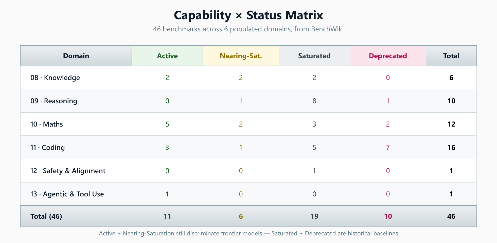

# Benchmark Catalog — Overview

> Notes 08–13 catalog every benchmark tracked by [BenchWiki](https://benchwiki.vercel.app)
> — 46 benchmarks across 6 capability domains — with the data an AI engineer actually
> needs to read a score correctly: status, contamination risk, run configuration, and
> lineage. This note explains the taxonomy those six files share, and how to use the
> catalog as a whole.

---

## Table of Contents

1. [Why This Catalog Exists](#1-why-this-catalog-exists)
2. [The Six Domain Catalogs](#2-the-six-domain-catalogs)
3. [The Status Taxonomy](#3-the-status-taxonomy)
4. [The Contamination Risk Scale](#4-the-contamination-risk-scale)
5. [Reading a Per-Benchmark Entry](#5-reading-a-per-benchmark-entry)
6. [A Note on Domain Boundaries](#6-a-note-on-domain-boundaries)
7. [How an AI Engineer Should Use This Catalog](#7-how-an-ai-engineer-should-use-this-catalog)

---

## 1. Why This Catalog Exists

[Model Evals — Framework & Capability Domains](./06-model-evals-capabilities.md) and
[Model Evals — Benchmarks & Harnesses](./07-model-evals-benchmarks-and-harnesses.md)
cover the *concepts*: what a capability domain is, what a benchmark is built from, and why
a bare "X% on benchmark Y" is not enough to trust a number. This catalog puts those
concepts into practice against **every benchmark BenchWiki currently tracks** — the
concrete dataset sizes, run configurations, contamination assessments, and status
histories behind the numbers that show up in launch posts and leaderboards.

Each of the six domain files (08–13) is generated directly from BenchWiki's structured
benchmark data (46 entries, each with a paper citation, dataset link, metric definition,
run configuration, human baseline where measured, and a contamination-risk assessment).
Every fact in those files traces back to that source data — this catalog does not add
outside claims about a benchmark beyond what BenchWiki records.

---

## 2. The Six Domain Catalogs

| # | Domain | Benchmarks | What it covers |
| :---: | --- | :---: | --- |
| 08 | [Knowledge](./08-benchmark-catalog-knowledge.md) | 6 | Factual recall and calibrated answers — Humanity's Last Exam, SimpleQA, GPQA, MMLU-Pro, MMLU, MMLU-Redux. |
| 09 | [Reasoning](./09-benchmark-catalog-reasoning.md) | 10 | Multi-step logical and commonsense reasoning — ARC-AGI-2, AGIEval, ARC-AGI, BIG-Bench Hard, CommonsenseQA, GLUE, HellaSwag, SuperGLUE, WinoGrande, BIG-Bench. |
| 10 | [Maths](./10-benchmark-catalog-maths.md) | 12 | Symbolic and numerical reasoning — FrontierMath, MathArena, OlympiadBench, PutnamBench, Soohak, AIME, MGSM, GSM8K, MATH, TabMWP, GSM-Hard, Omni-MATH. |
| 11 | [Coding](./11-benchmark-catalog-coding.md) | 16 | From function-level generation to repo-level agentic engineering — FrontierCode, SWE-bench Pro, Terminal-Bench, MBPP+, HumanEval(+), LiveCodeBench, MBPP, SWE-bench Verified, CodeContests, CodeXGLUE, CyberSecEval, Mercury, MultiPL-E, SWE-bench, SWE-Lancer. |
| 12 | [Safety & Alignment](./12-benchmark-catalog-safety-alignment.md) | 1 | Truthfulness under pressure to be agreeable — TruthfulQA. |
| 13 | [Agentic & Tool Use](./13-benchmark-catalog-agentic-tool-use.md) | 1 | Multi-step action-taking in an environment — ARC-AGI-3. |

**46 benchmarks total: 11 active, 6 nearing-saturation, 19 saturated, 10 deprecated** (see
the matrix above). Coding is both the largest domain (16 benchmarks) and the one with the
most deprecated entries (7) — a sign of how fast the field's coding benchmarks have
churned through generations as each one saturated or was superseded.

---

## 3. The Status Taxonomy

Every benchmark in the catalog carries one of four status labels. This is the single most
important column to check before trusting a score:

| Status | Meaning | What it implies |
| --- | --- | --- |
| **Active** | Frontier models still fail a meaningful fraction of the time; scores still separate strong models from weaker ones. | The benchmark is currently useful for comparing frontier systems. |
| **Nearing-Saturation** | Top models are clustering near the ceiling; the benchmark's power to discriminate is fading but not yet gone. | Treat differences between top models on this benchmark with caution — the gap may be noise, not capability. |
| **Saturated** | Top models have effectively maxed the benchmark out (see [Model Evals — Benchmarks & Harnesses, section 5](./07-model-evals-benchmarks-and-harnesses.md#5-why-benchmarks-can-be-misleading) on saturation). | The benchmark no longer meaningfully ranks frontier models. Useful as a historical baseline or a floor check, not for choosing between top models today. |
| **Deprecated** | The community has largely moved on, usually to a named `successor` benchmark. | A score on a deprecated benchmark tells you almost nothing about a 2025+ model's real capability — check the successor instead. |

Each domain file's **"At a Glance"** table is sorted exactly in this priority — active
first — so the benchmarks still worth paying attention to are always at the top of each
file.

---

## 4. The Contamination Risk Scale

Every entry also carries a `contamination` assessment — whether the benchmark's questions
(or close variants) plausibly leaked into training data, which inflates scores without
reflecting real capability (the **benchmark contamination** failure mode from
[note 07](./07-model-evals-benchmarks-and-harnesses.md#5-why-benchmarks-can-be-misleading)).
Each entry in the catalog states:

- **Whether the test set is public** — a public test set with published answers is far
  easier to end up in training data than a held-out or gated one.
- **The refresh cycle** — whether the benchmark rotates in fresh questions (lowering risk
  over time) or is static (risk only grows as more of the web references it).
  Reasoning gauge: a **static, fully public** test set is the highest-risk combination; a
  **gated or periodically refreshed private set** (e.g. a subset withheld from publication)
  is the lowest.
- **Any built-in mitigation** — some benchmarks hold back part of their data specifically
  to detect or resist contamination; others have none.
- **A summary risk level** — Low / Medium / High, given the above.

**Practical rule:** a **High** contamination risk on a **Saturated** benchmark is close to
worthless as a capability signal for a modern model — the score likely reflects
memorization more than reasoning. A **Low** or **Medium** risk on an **Active** benchmark
is where a score is most likely to reflect genuine capability.

---

## 5. Reading a Per-Benchmark Entry

Every benchmark entry in notes 08–13 follows the same nine-part structure, so once you know
it, you can navigate any entry in the catalog:

1. **Tagline** — one-line description of what the benchmark tests.
2. **Quick Facts** — status, launch date, dataset size, primary metric, human baseline,
   contamination risk, license, maintainer, at a glance.
3. **What it measures** — the task format and what capability it isolates.
4. **Evaluation protocol** — the run configuration (shots, chain-of-thought, temperature,
   pass@k, tools on/off) and the harnesses used to run it — the exact levers covered
   conceptually in [note 07, Part 2](./07-model-evals-benchmarks-and-harnesses.md#part-2--the-run-configuration).
5. **Status and saturation** — the evidence behind the status label, and any successor or
   lineage (parent benchmark / variants) relationship.
6. **Contamination risk** — the assessment described in section 4 above.
7. **Why it matters for an AI engineer** — a direct verdict: trust this score today, use
   it for your own comparisons, or treat it as historical.
8. **Performance snapshot** — a handful of representative points from the benchmark's
   published performance history, showing the trajectory rather than a single number.
9. **Source** — the paper, dataset, and leaderboard links.

---

## 6. A Note on Domain Boundaries

Two things worth flagging so this catalog doesn't read as inconsistent with the rest of
the series:

- **Knowledge and Reasoning are split here, combined in note 06.**
  [Note 06](./06-model-evals-capabilities.md#41-knowledge--reasoning) covers "Knowledge &
  Reasoning" as one combined capability domain (matching how frontier labs commonly group
  the two, e.g. under MMLU-style benchmarks that test both at once). BenchWiki tracks them
  as two **separate** primary domains, each with its own benchmark set — which is why they
  appear as two catalog files (08 and 09) here. Both framings are valid; use whichever
  matches the vocabulary of whatever you're reading elsewhere.

- **Vision-Multimodal and Long-Context have no dedicated catalog file yet.**
  Note 06 covers eight capability domains, including **Vision & Multimodal** and
  **Long Context**. BenchWiki's tag set recognizes both as capabilities — several
  benchmarks in this catalog carry them as a `secondary_capability` (for example, SWE-bench
  Verified is tagged with `long-context` alongside its primary `coding` label) — but as of
  this snapshot, BenchWiki has not yet published a *primary* benchmark entry for either. No
  catalog file was created for them here rather than inventing coverage BenchWiki doesn't
  yet have; check the live site for updates.

---

## 7. How an AI Engineer Should Use This Catalog

Tie this back to [Model Evals — Framework & Capability Domains, section 1](./06-model-evals-capabilities.md#1-why-ai-engineers-need-model-evals):
you will rarely run these benchmarks yourself, but reading them correctly is what lets you
compare models fairly, judge whether a new release is a real improvement, and make a
build-versus-buy call.

- **Start from the domain that matches your task**, not the whole catalog. If you're
  choosing a model for a coding agent, note 11 is your shortlist source; a bare "SWE-bench"
  number in a launch post should send you to that entry to check *which* SWE-bench variant,
  under *which* run configuration, at *what* contamination risk.
- **Weight Active and Nearing-Saturation benchmarks most heavily** when comparing frontier
  models today — that's where real capability differences still show up. Treat Saturated
  and Deprecated entries as literacy, not evidence: know what GSM8K measures because it's
  foundational vocabulary, but do not use a GSM8K score to pick between two 2025-era models.
- **Never read a score in isolation from its run configuration.** A `pass@1` number and a
  `maj@8` number on the same benchmark are not comparable, tools-on and tools-off are not
  comparable, and a vendor-reported number should be treated as a ceiling (see
  [note 07, section 4.1](./07-model-evals-benchmarks-and-harnesses.md#41-frontier-labs-the-model-builders))
  rather than an independently verified figure.
- **Check contamination risk before trusting a high score**, especially on any benchmark
  with a static, fully public test set that has been around long enough to be scraped into
  training data.
- **When nothing in this catalog matches your task closely enough, that is the signal to
  build your own eval set** — the third group in
  [note 07, section 4.3](./07-model-evals-benchmarks-and-harnesses.md#43-companies-and-ai-engineering-teams)
  exists precisely because no public benchmark answers "does this model work for *my*
  product, at *my* budget."

---

*Benchmark catalog — Overview. Data sourced from [BenchWiki](https://benchwiki.vercel.app).
Part of the Model Evals deep dive — see also
[Model Evals — Framework & Capability Domains](./06-model-evals-capabilities.md) and
[Model Evals — Benchmarks & Harnesses](./07-model-evals-benchmarks-and-harnesses.md).*
