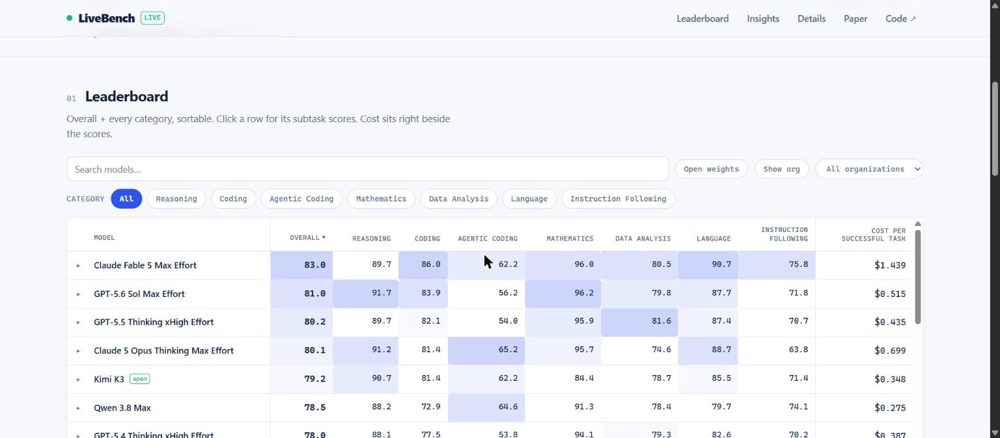
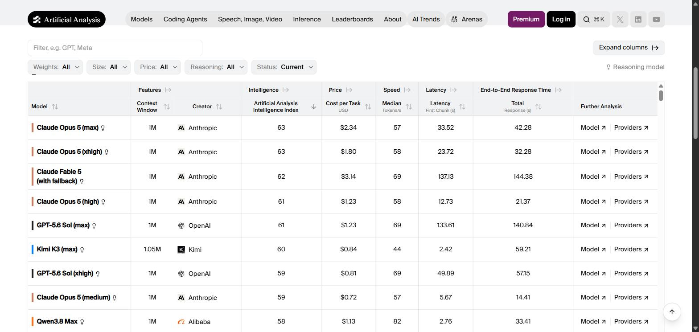
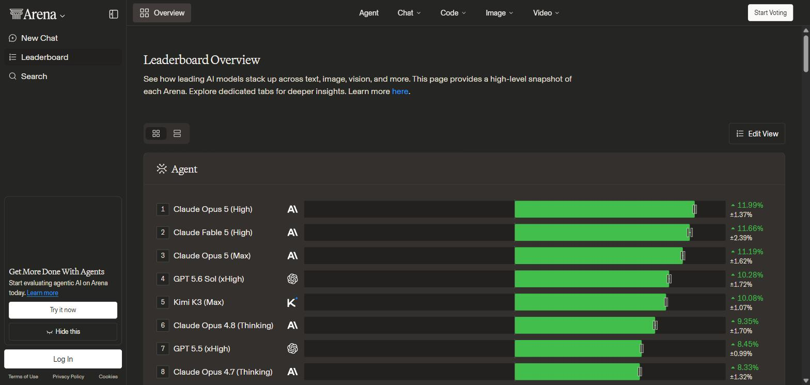
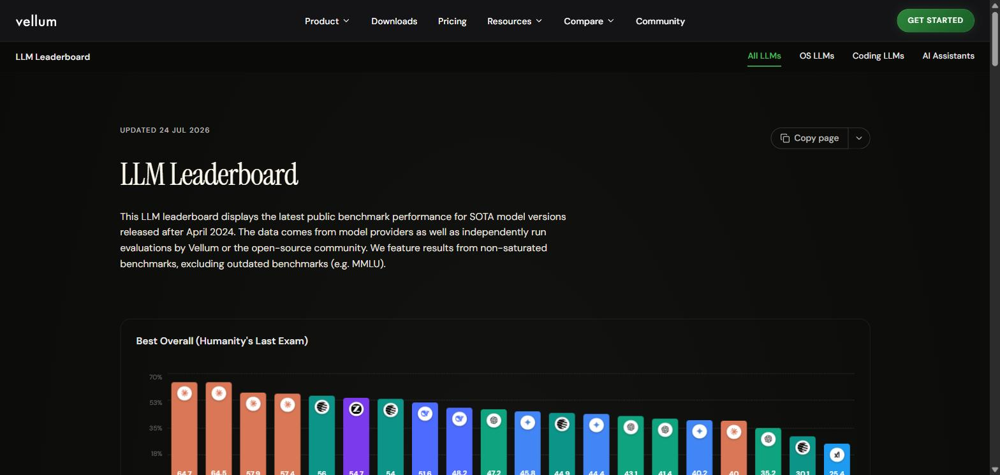
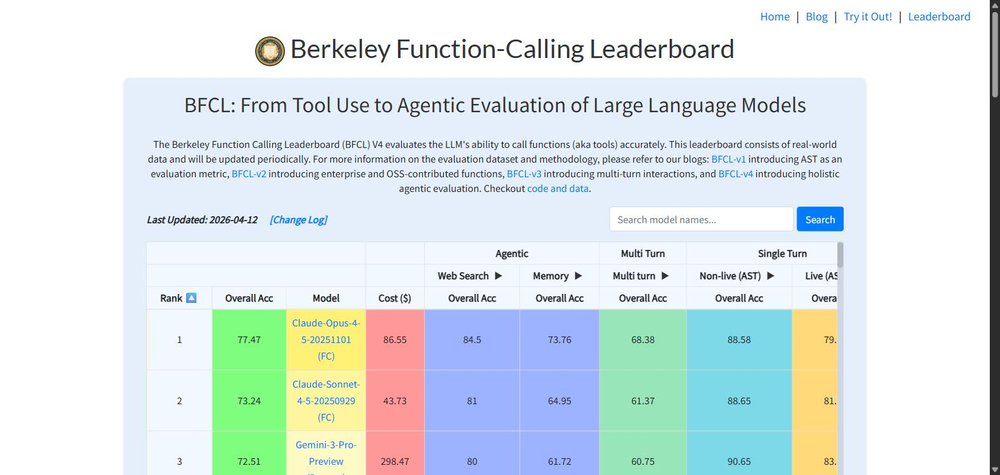
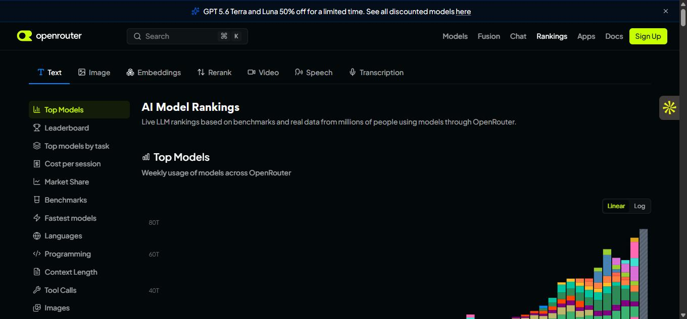

# LLM Leaderboards — Platforms

> [Fundamentals](./15-llm-leaderboards-fundamentals.md) covered the theory: why leaderboards
> exist, the four types, and why you can't fully trust any of them. This note puts faces to
> that theory — six real, actively maintained leaderboards, screenshotted live, mapped onto
> the taxonomy from note 15 so you know exactly which questions each one answers and which
> it doesn't.

Each entry below was visited directly (via browser automation) rather than recalled from
memory, so the screenshots and figures reflect what these platforms actually showed at the
time of writing. Leaderboards change weekly — treat every score below as illustrative of
*how to read the platform*, not as a current ranking.

---

## Table of Contents

1. [How to Use This Note](#1-how-to-use-this-note)
2. [LiveBench](#2-livebench)
3. [Artificial Analysis](#3-artificial-analysis)
4. [Arena (formerly LMArena / Chatbot Arena)](#4-arena-formerly-lmarena--chatbot-arena)
5. [Vellum LLM Leaderboard](#5-vellum-llm-leaderboard)
6. [Berkeley Function-Calling Leaderboard (BFCL)](#6-berkeley-function-calling-leaderboard-bfcl)
7. [OpenRouter Rankings](#7-openrouter-rankings)
8. [Other Platforms Worth Knowing](#8-other-platforms-worth-knowing)
9. [Platform Comparison Table](#9-platform-comparison-table)

---

## 1. How to Use This Note

Each platform entry answers the same five questions, mirroring the "read the board
correctly" checklist from
[note 15, section 5, step 3](./15-llm-leaderboards-fundamentals.md#step-3--read-the-board-correctly):

- **What type of leaderboard is it?** (using the four types from
  [note 15, section 3](./15-llm-leaderboards-fundamentals.md#3-the-four-types-of-llm-leaderboards))
- **What exactly does it score, and how?**
- **Who runs it, and is it independent or self-reported?**
- **What's it best for — and what should you not use it for?**
- **A live screenshot**, so you know what to expect when you open it.

---

## 2. LiveBench

**Type:** Multi-benchmark leaderboard, independently run.

**What it scores:** LiveBench bills itself explicitly as a **"contamination-free"**
benchmark. It runs **23 objective tasks across 7 categories** — Reasoning, Coding, Agentic
Coding, Mathematics, Data Analysis, Language, and Instruction Following — and, critically,
**refreshes its question set every six months**. Older questions are retired and replaced
before they've had time to leak into training data, which directly targets the
**benchmark contamination** failure mode from
[note 15, section 4.2](./15-llm-leaderboards-fundamentals.md#42-benchmark-contamination-can-inflate-scores).
The site lets you pick a specific release date on a timeline and compare scores "down to
the subtask," and **cost sits right beside the scores** — in the screenshot above, Claude
Fable 5 (Max Effort) leads overall at 83.0, but at $1.439 per successful task versus Kimi
K3's $0.348 at a close 79.2 — a price/performance trade-off the raw ranking alone would
hide.

**Who runs it:** An independent academic/research effort (not a lab or vendor), which is
part of why it carries trust as a cross-lab reference point (see
[note 15, section 1](./15-llm-leaderboards-fundamentals.md#1-why-leaderboards-exist)).

**Best for:** A general capability + cost view that resists staleness better than most
static benchmarks, thanks to the refresh cycle. **Not for:** application-specific
decisions — its 7 categories are broad academic-style tasks, not your production workload.

## 3. Artificial Analysis

**Type:** Multi-benchmark leaderboard, independently run, with a heavy operational-metrics
focus.

**What it scores:** Positions itself as **"Independent analysis of AI"** and compares
**over 250 models** across five dimensions at once: the **Artificial Analysis Intelligence
Index**, **Price** (cost per task in USD), **Output Speed** (tokens/sec), **Latency**
(time to first chunk), and **End-to-End Response Time**. This is the clearest embodiment of
the multi-benchmark leaderboard's promise from
[note 15, section 3.2](./15-llm-leaderboards-fundamentals.md#32-multi-benchmark-leaderboards) —
capability and deployment economics on the same row, filterable by weights (open vs.
closed), model size, price, and reasoning effort. Its homepage highlights alone
(Intelligence, Speed, Cost per Task) make it fast to answer "who's cheapest at a given
intelligence bar" without opening the full table.

**Who runs it:** An independent analysis firm; the "Independent" framing in its own
tagline is a direct answer to the
[who-ran-the-model question](./15-llm-leaderboards-fundamentals.md#step-3--read-the-board-correctly)
from note 15 — useful context, though independence claims are themselves worth verifying
rather than taking at face value.

**Best for:** Budget-constrained model selection (see
[note 15, section 5, step 2](./15-llm-leaderboards-fundamentals.md#step-2--pick-the-board-that-matches-your-task)) —
this is the board that "carries price and throughput" the fundamentals note points you
toward. **Not for:** deep task-specific evaluation — the Intelligence Index is a composite,
and composites hide category weights (
[note 15, section 4.4](./15-llm-leaderboards-fundamentals.md#44-overall-rankings-depend-on-subjective-design-choices)).

## 4. Arena (formerly LMArena / Chatbot Arena)

**Type:** Human-preference-based leaderboard — the canonical example of the type described
in [note 15, section 3.3](./15-llm-leaderboards-fundamentals.md#33-human-preference-based-leaderboards).

**What it scores:** Users vote on anonymous head-to-head responses; models are ranked by
how often they win. What's easy to miss from a static ranking screenshot: **the platform
publishes confidence intervals right next to every score** — in the shot above, Claude
Opus 5 (High) leads the Agent arena at 11.99% win rate, but with a **±1.37%** interval,
and the next several models overlap within a couple of points of each other. This is the
live version of
[note 15, section 4.5](./15-llm-leaderboards-fundamentals.md#45-small-score-differences-may-not-be-meaningful):
without those intervals, you'd read a clean 1-through-10 ranking; with them, several of
those "ranks" are statistically tied. The site runs **separate arenas** — Agent, Text
(chat), WebDev, Vision, Document, Text-to-Image, Image Edit, Text-to-Video, Image-to-Video,
Video Edit, and Search — each with its own leaderboard, because a model's chat ranking and
its coding-agent ranking can diverge sharply.

**Who runs it:** Originally LMSYS's "Chatbot Arena," now operating under the **Arena**
brand at `arena.ai`. Votes come from real users interacting with the site, so the voting
population — skews toward people who seek out AI leaderboards — is a factor per
[note 15, section 4.6](./15-llm-leaderboards-fundamentals.md#46-human-preference-leaderboards-have-human-biases).

**Best for:** Conversational quality, tone, and "which response would a person pick" —
exactly the qualities hard to grade automatically. **Not for:** factual correctness or
reasoning rigor — a confident, well-formatted wrong answer can out-vote a correct but
terse one, which is the core limitation the fundamentals note calls out explicitly.

## 5. Vellum LLM Leaderboard

**Type:** Multi-benchmark leaderboard, aggregating public results rather than running its
own evaluation from scratch.

**What it scores:** Vellum (an LLM engineering/ops platform) publishes a leaderboard that
explicitly states its curation policy on the page itself:

> *"This LLM leaderboard displays the latest public benchmark performance for SOTA model
> versions released after April 2024. The data comes from model providers as well as
> independently run evaluations by Vellum or the open-source community. **We feature
> results from non-saturated benchmarks, excluding outdated benchmarks (e.g. MMLU).**"*

That last sentence is worth pausing on — it's a leaderboard curator actively applying the
**saturation** concept from
[note 07](./07-model-evals-benchmarks-and-harnesses.md#5-why-benchmarks-can-be-misleading)
and the [Benchmark Catalog](./14-benchmark-catalog-overview.md)'s status labels as an
editorial filter, rather than showing every historical benchmark regardless of whether it
still discriminates between models. Its "Best Overall" chart is currently built on
Humanity's Last Exam, and the site also splits into **All LLMs, OS LLMs, Coding LLMs, and
AI Assistants** sub-boards.

**Who runs it:** Vellum, mixing self-reported vendor numbers with independently-run scores —
so the [who-ran-it question](./15-llm-leaderboards-fundamentals.md#step-3--read-the-board-correctly)
has a mixed answer here and is worth checking per model.

**Best for:** A quick, curated "what's current" view that has already done some of the
saturation-filtering work for you. **Not for:** assuming every number is independently
verified — check the per-model source given the mixed self-reported/independent data.

## 6. Berkeley Function-Calling Leaderboard (BFCL)

**Type:** Application-specific leaderboard — the type from
[note 15, section 3.4](./15-llm-leaderboards-fundamentals.md#34-application-specific-leaderboards),
narrowly scoped to one capability.

**What it scores:** BFCL (now on **V4**, subtitled *"From Tool Use to Agentic Evaluation of
Large Language Models"*) evaluates a model's ability to **call functions/tools
accurately** using real-world data. The V4 breakdown in the screenshot shows just how far
past a single "accuracy" number this has grown: **Agentic** (Web Search, Memory),
**Multi-Turn**, and **Single-Turn** (Non-live and Live, each scored via AST parsing), each
with its own **Overall Acc** column — plus a **Cost ($)** column right next to accuracy,
so a top rank at a high cost (Gemini-3-Pro-Preview at $298.47 vs. Claude-Sonnet-4-5 at
$43.73, for close accuracy) is visible immediately rather than buried in a separate page.
This is exactly the board
[note 15, section 5, step 2](./15-llm-leaderboards-fundamentals.md#step-2--pick-the-board-that-matches-your-task)
names for tool-use tasks.

**Who runs it:** UC Berkeley's Gorilla research group — an academic, independent source.

**Best for:** Choosing a model for agentic tool-calling or multi-turn agent workflows
specifically. **Not for:** general chat quality or knowledge-heavy tasks — it says nothing
about those.

## 7. OpenRouter Rankings

**Type:** A fifth pattern worth naming alongside note 15's four types — a **usage-based /
revealed-preference leaderboard**. Rather than a benchmark score or a vote, it ranks models
by **actual API traffic**.

**What it scores:** OpenRouter is an LLM API routing platform; its Rankings page describes
itself as *"Live LLM rankings based on benchmarks and real data from millions of people
using models through OpenRouter."* The headline view is **weekly token usage per model**
across the platform, with further breakdowns by **Top models by task, Cost per session,
Market share, Benchmarks, Fastest models, Languages, Programming, Context length, and Tool
calls**. This measures something genuinely different from every other platform in this
note: not "which model scores highest" or "which model do voters prefer in a blind test,"
but **which model real paying developers are actually routing production traffic to** —
closer to a market signal than an evaluation.

**Who runs it:** OpenRouter, from its own platform's traffic — which is also its
limitation: it reflects **OpenRouter's user base**, not the entire market, and raw usage
correlates with factors like price and default-model status as much as quality.

**Best for:** A sanity check on whether a model that scores well elsewhere is *also* seeing
real adoption — a useful cross-reference against the other, more synthetic leaderboard
types. **Not for:** capability comparison on its own; a cheap, heavily-marketed model can
out-rank a better one here purely on price or defaults.

## 8. Other Platforms Worth Knowing

A few more, covered briefly rather than with a full profile — either because they're
narrower in scope or because a live screenshot wasn't captured for this note:

| Platform | Type | What it's for |
| --- | --- | --- |
| **Hugging Face Open LLM Leaderboard** | Benchmark-specific / open-weight focused | The community reference point for comparing **open-weight** models specifically — directly serves the "open-weight ecosystem" discovery function from [note 15, section 2](./15-llm-leaderboards-fundamentals.md#2-who-needs-them-and-for-what). |
| **MTEB (Massive Text Embedding Benchmark)** | Benchmark-specific | The reference leaderboard for **embedding models** — the board [note 15](./15-llm-leaderboards-fundamentals.md#step-2--pick-the-board-that-matches-your-task) points to for RAG/retrieval tasks. |
| **SWE-bench / Terminal-Bench / OSWorld leaderboards** | Application-specific | Official leaderboards tied to specific benchmarks in the [Benchmark Catalog](./14-benchmark-catalog-overview.md) — see [note 11 (Coding)](./11-benchmark-catalog-coding.md) and [note 13 (Agentic & Tool Use)](./13-benchmark-catalog-agentic-tool-use.md) for the underlying benchmark details, including status and contamination risk. |
| **HELM (Stanford)** | Multi-benchmark, independently run | An academic, transparency-first leaderboard — referenced in [note 07, section 4](./07-model-evals-benchmarks-and-harnesses.md#4-who-runs-model-evals) as the kind of independent evaluator whose numbers carry more weight than vendor self-reports. |

---

## 9. Platform Comparison Table

| Platform | Type ([note 15 §3](./15-llm-leaderboards-fundamentals.md#3-the-four-types-of-llm-leaderboards)) | Scored by | Cost/latency shown? | Best for |
| --- | --- | --- | --- | --- |
| **LiveBench** | Multi-benchmark | Automated tasks, refreshed every 6 months | Yes | Contamination-resistant general capability + cost |
| **Artificial Analysis** | Multi-benchmark | Automated + Intelligence Index composite | Yes, extensively | Budget-constrained model selection |
| **Arena** | Human-preference | Blind human votes | No | Conversational quality, tone |
| **Vellum** | Multi-benchmark (curated) | Mixed self-reported + independent | Partial | Quick curated "what's current" |
| **BFCL** | Application-specific | Automated (AST parsing) tool-call tests | Yes | Tool use / function calling |
| **OpenRouter Rankings** | Usage-based (revealed preference) | Real API traffic | Cost per session, yes | Cross-check against real adoption |

---

*Notes on LLM Leaderboard platforms — LiveBench, Artificial Analysis, Arena, Vellum, BFCL,
OpenRouter, and a few more, mapped onto the theory from
[LLM Leaderboards — Fundamentals](./15-llm-leaderboards-fundamentals.md).*
