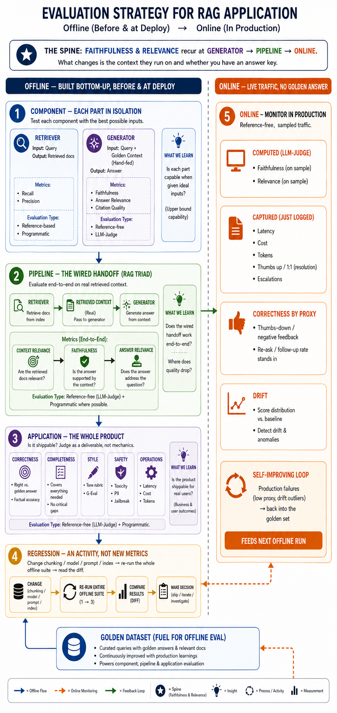

# LLM Evaluations: Study Notes

A structured set of notes on LLM Evaluations (Evals). It covers core concepts, the
practical evaluation workflow, and production-grade online monitoring. Each note is
self-contained but builds on the previous one, so the reading order below is recommended
for a first pass.

---

## Reading Order

| # | Notes | What it covers |
| :---: | --- | --- |
| 1 | [What are LLM Evals?](./01-llm_evals.md) | Definition, evals vs. metrics, and the two domains: **Model Evals** vs. **Application Evals**. |
| 2 | [The Application Evaluation Workflow](./02-llm_application_evaluation_workflow.md) | The **11-step loop** (Zomato email-router case study), from defining the task to monitoring and feedback. |
| 3 | [Why Multiple Eval Pipelines](./03-why-multiple-eval-pipelines.md) | The **failure levels** (component / workflow / application), the K=5 RAG breakdown, and the risk matrix (Quality / Safety / Operations). |
| 4 | [LLM Evaluation Methods](./04-llm-evaluation-methods.md) | The three methods: **Programmatic**, **Human-based**, and **LLM-as-a-Judge**, plus reference-based vs. reference-free and offline vs. online. |
| 5 | [Offline vs. Online Evals](./05-offline-vs-online-evals.md) | The online evaluation pipeline and a deep dive on **Computed vs. Captured** criteria; the self-improving loop. |

### Model Evals: Deep Dive

Notes 1 to 5 focus mostly on **Application Evals**. These two expand the **Model Evals**
domain introduced in note 1 (evaluating the base model itself).

| # | Notes | What it covers |
| :---: | --- | --- |
| 6 | [Model Evals: Framework & Capability Domains](./06-model-evals-capabilities.md) | Why model evals matter, the common eval arc, public benchmark vs. own eval set, and the **eight capability domains** in detail. |
| 7 | [Model Evals: Benchmarks & Harnesses](./07-model-evals-benchmarks-and-harnesses.md) | The **anatomy of a benchmark** (dataset, run config, scoring, aggregation), the eval loop, eval harnesses, who runs evals, and why benchmarks mislead. |

### Benchmark Catalog: Every Benchmark, by Domain

Notes 8 to 14 turn the concepts from notes 6 and 7 into a reference: every benchmark
tracked by [BenchWiki](https://benchwiki.vercel.app), organized into six
capability-domain catalogs, with status, contamination risk, run configuration, and
lineage for each one.

| # | Notes | What it covers |
| :---: | --- | --- |
| 8 | [Benchmark Catalog: Knowledge](./08-benchmark-catalog-knowledge.md) | 6 benchmarks: Humanity's Last Exam, SimpleQA, GPQA, MMLU-Pro, MMLU, MMLU-Redux. |
| 9 | [Benchmark Catalog: Reasoning](./09-benchmark-catalog-reasoning.md) | 10 benchmarks: ARC-AGI-2, AGIEval, ARC-AGI, BIG-Bench Hard, CommonsenseQA, GLUE, HellaSwag, SuperGLUE, WinoGrande, BIG-Bench. |
| 10 | [Benchmark Catalog: Maths](./10-benchmark-catalog-maths.md) | 12 benchmarks: FrontierMath, MathArena, OlympiadBench, PutnamBench, Soohak, AIME, MGSM, GSM8K, MATH, TabMWP, GSM-Hard, Omni-MATH. |
| 11 | [Benchmark Catalog: Coding](./11-benchmark-catalog-coding.md) | 16 benchmarks: FrontierCode, SWE-bench Pro, Terminal-Bench, MBPP+, HumanEval(+), LiveCodeBench, MBPP, SWE-bench Verified, CodeContests, CodeXGLUE, CyberSecEval, Mercury, MultiPL-E, SWE-bench, SWE-Lancer. |
| 12 | [Benchmark Catalog: Safety & Alignment](./12-benchmark-catalog-safety-alignment.md) | TruthfulQA, plus an honest note on this domain's current (narrow) coverage. |
| 13 | [Benchmark Catalog: Agentic & Tool Use](./13-benchmark-catalog-agentic-tool-use.md) | ARC-AGI-3, and where the rest of agentic evaluation currently lives. |
| 14 | [Benchmark Catalog: Overview](./14-benchmark-catalog-overview.md) | The shared taxonomy (status, contamination risk), how to read an entry, and how to use the catalog as an AI engineer. |

### LLM Leaderboards

Notes 15 and 16 move from individual benchmarks to leaderboards: how benchmark scores get
aggregated, published, and compared across models, and why that aggregation step
introduces its own failure modes on top of the ones already covered for benchmarks.

| # | Notes | What it covers |
| :---: | --- | --- |
| 15 | [LLM Leaderboards: Fundamentals](./15-llm-leaderboards-fundamentals.md) | Why leaderboards exist, who needs them, the **four types**, **seven reasons** you can't fully trust them, and a **five-step framework** for reading them as an AI engineer. |
| 16 | [LLM Leaderboards: Platforms](./16-llm-leaderboards-platforms.md) | Six real leaderboards with live screenshots: LiveBench, Artificial Analysis, Arena, Vellum, BFCL, and OpenRouter, mapped onto the note 15 taxonomy. |

### RAG Evals

Notes 17 and 18 zoom into Retrieval-Augmented Generation specifically, the running example
from note 3's K=5 breakdown. This is where the component-vs-workflow failure split gets
its own dedicated metrics and tooling.

| # | Notes | What it covers |
| :---: | --- | --- |
| 17 | [RAG Evals: Fundamentals](./17-rag-evals-fundamentals.md) | The **RAG Triad**, retrieval-stage IR metrics (Precision@K, Recall@K, MRR, NDCG), the core generation-stage metrics with exact formulas (Faithfulness, Context Precision, Context Recall, Answer Relevancy/Correctness), and how claim-level faithfulness checking works. |
| 18 | [RAG Evals: Building the Practice](./18-rag-evals-practice.md) | Synthetic golden dataset generation, how chunking strategy distorts retrieval scores, a framework comparison (RAGAS, DeepEval, TruLens, Arize Phoenix), multi-hop and agentic RAG evaluation, and common pitfalls. |

**Visual overview: evaluation strategy for a RAG application.** RAG evaluation sits
entirely under **Application Evals** in note 1's Model vs. Application split, since it
evaluates a system built around a model, not the base model itself. The diagram below
walks the full strategy end to end: Component evals (retriever and generator tested in
isolation), Pipeline evals (the RAG Triad, on the real wired handoff between retriever and
generator), Application evals (the whole product judged as a deliverable), Regression (the
same offline suite re-run after any change), and Online monitoring in production, all fed
by, and feeding back into, one Golden Dataset.



Every layer in this diagram maps onto a note already in this series. Component and
Pipeline map to the [component vs. workflow failure levels in note 3](./03-why-multiple-eval-pipelines.md#1-core-reason-1-multiple-failure-points),
Pipeline's metrics are the [RAG Triad from note 17](./17-rag-evals-fundamentals.md#2-the-rag-triad),
the Golden Dataset box is [note 2's Golden Dataset step](./02-llm_application_evaluation_workflow.md#step-3--build-a-golden-dataset),
and the Online column is [note 5's Computed vs. Captured criteria and self-improving loop](./05-offline-vs-online-evals.md#10-the-self-improving-loop).

---

## The Big Picture

The series moves through three stages: understanding *what* evals are, learning *how* to
run them, and applying them *in production*.

```
        WHAT                        HOW                        IN PRODUCTION
   +--------------+        +----------------------+       +--------------------+
   | 1. Concepts  |        | 2. 11-step workflow  |       | 5. Online evals    |
   | Model vs App |  --->  | 3. Why many pipelines| --->  | Computed vs        |
   |              |        | 4. Eval methods      |       | Captured + loop    |
   +--------------+        +----------------------+       +--------------------+
```

**Throughline:** Define clear criteria, build a Golden Dataset, pick an evaluation method,
then run, analyze, improve, and iterate. Once the system meets its threshold, deploy it
and monitor live traffic, feeding real-world failures back into the Golden Dataset. That
final feedback path is the self-improving loop.

---

## Folder Structure

```
├── README.md                                   (index, this file)
├── 01-llm_evals.md                             concepts
├── 02-llm_application_evaluation_workflow.md   the 11-step workflow
├── 03-why-multiple-eval-pipelines.md           failure levels + risk matrix
├── 04-llm-evaluation-methods.md                the three evaluation methods
├── 05-offline-vs-online-evals.md               computed vs. captured
├── 06-model-evals-capabilities.md              model evals + 8 capabilities
├── 07-model-evals-benchmarks-and-harnesses.md  benchmarks, loop, harnesses
├── 08-benchmark-catalog-knowledge.md           catalog: knowledge (6)
├── 09-benchmark-catalog-reasoning.md           catalog: reasoning (10)
├── 10-benchmark-catalog-maths.md               catalog: maths (12)
├── 11-benchmark-catalog-coding.md              catalog: coding (16)
├── 12-benchmark-catalog-safety-alignment.md    catalog: safety & alignment (1)
├── 13-benchmark-catalog-agentic-tool-use.md    catalog: agentic & tool use (1)
├── 14-benchmark-catalog-overview.md            catalog taxonomy + how to use it
├── 15-llm-leaderboards-fundamentals.md         why/types/limits/how to read leaderboards
├── 16-llm-leaderboards-platforms.md            6 platforms w/ live screenshots
├── 17-rag-evals-fundamentals.md                RAG Triad, IR metrics, generation metrics
├── 18-rag-evals-practice.md                    datasets, chunking, frameworks, pitfalls
└── images/
    ├── llm-evaluation-workflow.png          (used by note 2)
    ├── failure-points-target.png            (used by note 3)
    ├── computed-vs-captured.png             (used by note 5)
    ├── online-eval-pipeline.png             (used by note 5)
    ├── benchmark-eval-loop.png              (used by note 7)
    ├── benchmark-status-matrix.png          (used by note 14)
    ├── rag-evaluation-strategy.png          (used in README)
    └── leaderboards/                        (used by note 16)
        ├── livebench.jpg
        ├── artificial-analysis.jpg
        ├── arena.jpg
        ├── vellum.jpg
        ├── bfcl.jpg
        └── openrouter.jpg
```

---

## Key Terms Quick Reference

| Term | Meaning |
| --- | --- |
| **Golden Dataset** | Curated 50 to 500 row test set with ground-truth labels; the backbone of offline evals. |
| **Recall @ K** | Fraction of relevant documents a retriever fetches within its top-K results. |
| **LLM-as-a-Judge** | Using a capable LLM to grade outputs, giving human-like nuance at program speed and cost. |
| **MAE (Mean Absolute Error)** | Average deviation between LLM grades and human grades; the goal is to drive it toward 0. |
| **Groundedness / Faithfulness** | Whether an answer is strictly supported by the retrieved context. |
| **Captured criteria** | Metrics read directly from the trace (latency, cost, tokens, thumbs, escalation). |
| **Computed criteria** | Metrics produced by an evaluator (faithfulness, toxicity, hallucination, relevance). |
| **Self-Improving Loop** | Live failures added to the Golden Dataset, re-run through offline evals, then redeployed. |

---

*A study series on LLM Evaluations. Start at [note 1](./01-llm_evals.md).*
