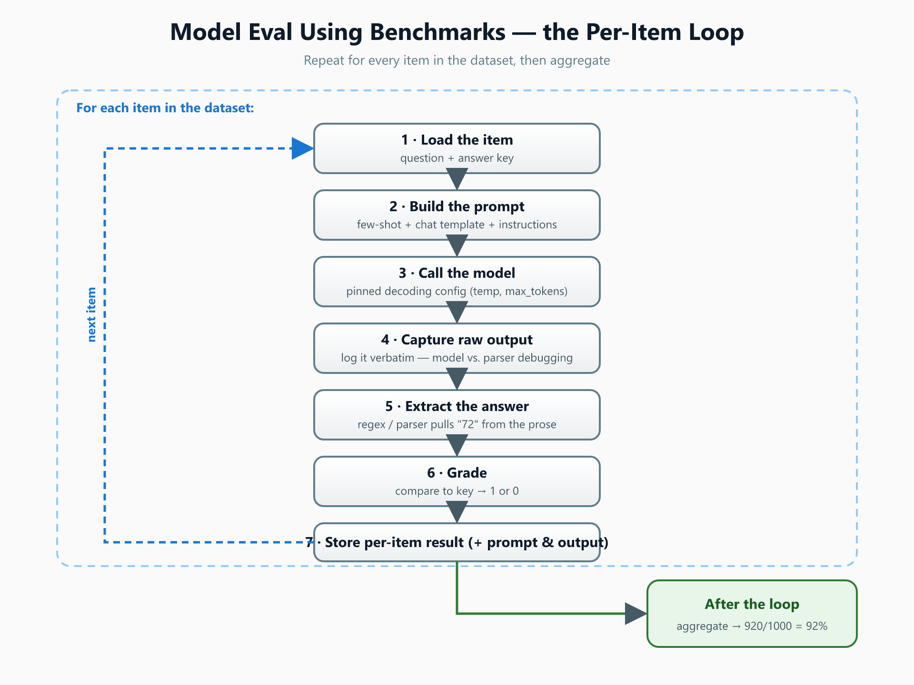

# Model Evals — Benchmarks, the Eval Loop & Harnesses

> A **benchmark** is a standardised test used to measure a particular model capability.
> This note dissects the **anatomy of a benchmark**, walks through the **evaluation loop**
> that runs it, explains why an **eval harness** is needed, who runs model evals, and the
> ways benchmark numbers can **mislead**.

This continues from [Model Evals — Framework & Capability Domains](./model-evals-capabilities.md).

---

## Table of Contents

1. [The Anatomy of a Benchmark (Four Parts)](#1-the-anatomy-of-a-benchmark-four-parts)
   - [Part 1 — The Dataset](#part-1--the-dataset)
   - [Part 2 — The Run Configuration](#part-2--the-run-configuration)
   - [Part 3 — The Scoring Method](#part-3--the-scoring-method)
   - [Part 4 — The Aggregation](#part-4--the-aggregation)
2. [Model Eval Using Benchmarks: The Loop](#2-model-eval-using-benchmarks-the-loop)
3. [The Need for an Eval Harness](#3-the-need-for-an-eval-harness)
4. [Who Runs Model Evals?](#4-who-runs-model-evals)
5. [Why Benchmarks Can Be Misleading](#5-why-benchmarks-can-be-misleading)

---

## 1. The Anatomy of a Benchmark (Four Parts)

Every benchmark is built from four parts: a **dataset**, a **run configuration**, a
**scoring method**, and an **aggregation** step.

### Part 1 — The Dataset

The dataset is the **questions plus the answer key**. For example, **GSM8K**: a few thousand
grade-school word problems, each paired with its correct number.

> *"Natalia sold clips to 48 friends in April, and then she sold half as many clips in May.
> How many clips did she sell altogether?"*
> **Answer: 72**

### Part 2 — The Run Configuration

The run configuration is the list of **all settings under which the model was run** during
the evaluation. Change these and the same model produces very different scores — which is why
comparability demands they be pinned and reported. It has three layers.

**(a) Prompt construction** — how the question is worded and framed.

- **Zero-shot vs. few-shot** — do you show worked examples first? GSM8K is classically
  reported **8-shot**. Few-shot examples reliably lift scores because they teach the model
  the expected format.
- **Chain-of-thought vs. direct** — ask bluntly and models blurt a wrong number; add
  *"think step by step"* and the model works through it (48 in April, half is 24 in May,
  48 + 24 = 72) and accuracy jumps a lot.

**(b) Decoding / sampling configuration** — how tokens are generated.

- **Temperature** — at `temperature = 0` (greedy), the model picks the most likely token
  every time: deterministic and reproducible. Above 0 it samples, so the same prompt gives
  different answers on different runs. Most benchmarks use greedy for reproducibility.
- **max_tokens** — chain-of-thought needs room. Cap `max_tokens` too low and the model is
  cut off mid-reasoning, never emits its final answer, and scores zero on a question it was
  solving correctly. That is **not a capability failure — it is a config failure** that
  looks identical in the score.

**(c) Scoring strategy & environment** — how many attempts, and with what tools.

- **Single vs. multiple attempts:**
  - **pass@1** — one attempt.
  - **pass@k** — k attempts, counted right if any succeed.
  - **maj@k** (self-consistency) — sample k times, take the majority answer.
  These are **dramatically different numbers** on the same model. A model at 92% `maj@8`
  might be 85% `pass@1`. If a report does not say which, the number is uninterpretable.
- **Tools on or off** — a model with a Python interpreter scores very differently on math
  than one without. Same model, same questions, tools toggled: a large score gap. *GSM8K
  with code execution is barely the same test as GSM8K without.*

### Part 3 — The Scoring Method

Scoring is how an **output becomes a number**. Two sub-steps:

**(a) Extraction — finding the answer in the output.** The model does not emit `72`. It
emits *"Natalia sold 48 clips in April. Half of 48 is 24. So 48 + 24 = 72 clips
altogether."* Something must pull `72` out of that — usually a **regex** ("take the last
number," or parse after `####`). This is **fragile and rarely discussed**: if the model
answers `72 clips` or `$72` or `seventy-two`, does your parser catch it? A brittle extractor
scores a correct model as wrong.

**(b) Comparison — deciding if the extracted answer is right.** For GSM8K: does `72` equal
the key's `72`? Trivial. This is what **closed-ended** means — one right answer, automatic
grading, nothing to argue about.

> Contrast **open-ended** — *"write a good summary."* There is no answer key, so you need a
> human or an **LLM judge**, and now the grader itself becomes a source of **error and
> bias**. Most benchmark controversy lives here.

### Part 4 — The Aggregation

You have graded thousands of items, each right or wrong. Aggregation **collapses them into a
summary**: 920 of 1,000 → *"92% on GSM8K."*

Aggregation has its own choices — for example an **unweighted mean** vs. a mean **weighted by
subject** (MMLU has **57 subjects of unequal size**, so the weighting scheme can change the
headline number and even the ranking between models).

---

## 2. Model Eval Using Benchmarks: The Loop

An evaluation is a **loop over the dataset**. Per item:

1. **Load the item** — question + answer.
2. **Build the prompt** — inject few-shot examples, apply the chat template, add
   instructions. Now you have the exact string (or message list) the model sees.
3. **Call the model** — with the pinned decoding config (temperature, max_tokens, etc.). For
   an API model this is an HTTP call; for a local model, a forward pass.
4. **Capture the raw output** — and **log it verbatim**. This matters: when a score looks
   wrong, the raw outputs are the only way to tell whether **the model failed or your parser
   did**.
5. **Extract the answer** — regex or parser pulls `72` out of the prose.
6. **Grade** — compare against the key → 1 or 0.
7. **Store** — the per-item result, plus the prompt and output that produced it.

**After the loop:** aggregate the per-item scores → the headline number.

---

## 3. The Need for an Eval Harness

At first, evaluation seems simple:

> Take a question → send it to the model → check the answer → repeat for all questions.

But in practice you also need to handle:

- **Extracting the final answer correctly** when the model writes *"The answer is C"*, *"C."*, or *"Option C"*.
- **Scoring answers using the benchmark's exact method.**
- **Sending thousands of questions efficiently in batches.**
- **Retrying failed API requests.**
- **Handling rate limits.**

An **evaluation harness** is a ready-made system that already handles these details. The
harness already knows:

- Where to get the benchmark questions (GSM8K, MMLU, etc.).
- How to format each question.
- How to send it to the model.
- How to extract the model's answer.
- How to judge whether it is correct.
- How to calculate the final benchmark score.

> **A benchmark is the exam paper. An evaluation harness is the complete exam administration
> system:** instructions, answer-sheet format, checking rules, and score calculation.

Tools such as **lm-evaluation-harness**, **Inspect**, and **HELM** act as an eval harness.

---

## 4. Who Runs Model Evals?

Model evals are run by several different groups, each with a different motive:

- **Frontier AI labs (internally).** Before releasing a model, labs run large internal eval
  suites to benchmark capability, catch regressions, and produce the numbers published in
  model cards and launch posts.
- **Independent third parties and academia.** Groups like Stanford's **HELM** and various
  university teams run standardized, transparent evals so comparisons do not depend solely on
  a vendor's self-reported figures.
- **Government AI safety institutes.** Bodies such as the UK and US AI Safety Institutes run
  pre-deployment safety and dangerous-capability evals on frontier models.
- **The open-source community.** Projects like EleutherAI's **lm-evaluation-harness** and
  public leaderboards let anyone reproduce and compare open-model scores.
- **Application engineers.** Teams building products run **their own eval sets** on candidate
  models to make build-versus-buy and model-selection decisions for their specific task.

---

## 5. Why Benchmarks Can Be Misleading

A single headline number hides a lot. Four recurring ways benchmarks mislead:

- **Benchmark contamination.** The benchmark's questions (or close variants) leaked into the
  model's **training data**, so the model has effectively *seen the answers*. The score then
  reflects memorization, not capability — and looks like genuine skill.
- **Benchmark saturation.** Top models cluster near the ceiling (e.g. 95–100%). Once everyone
  scores about the same, the benchmark **loses its power to discriminate** between models and
  stops being informative — which is why labs keep introducing harder successor benchmarks.
- **Configuration gaming.** Because the run configuration (few-shot count, chain-of-thought,
  `maj@k`, tools on/off) swings scores so much, a vendor can **cherry-pick the settings**
  that flatter their model and compare against a competitor's number obtained under weaker
  settings. Same benchmark, non-comparable numbers.
- **Aggregation.** A single averaged score **hides per-category weakness** — a model can post
  a strong overall MMLU number while being poor at a specific subject. Weighting choices
  across unequal categories can also shift the ranking between two models.

> **Takeaway.** A benchmark number is only meaningful alongside its **run configuration,
> scoring strategy, and contamination status.** Treat a bare "X% on benchmark Y" as
> incomplete.

---

*Notes on benchmark anatomy, the evaluation loop, eval harnesses, and benchmark pitfalls.
Part of the Model Evals deep dive — see also
[Model Evals — Framework & Capability Domains](./model-evals-capabilities.md).*
